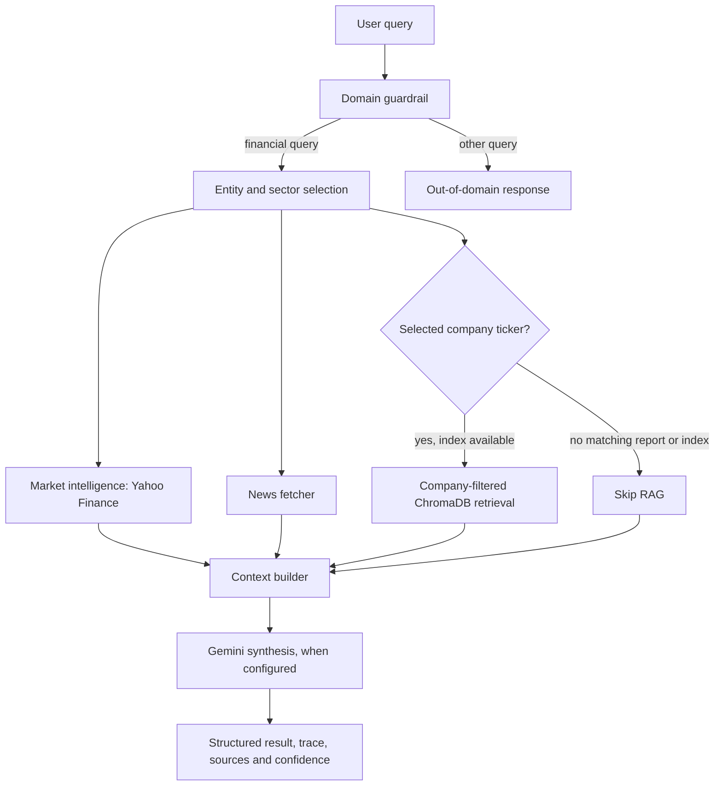

# FinRAG

FinRAG is an AI-powered financial research platform focused on Indian-listed companies and sectors. It combines market information from Yahoo Finance, recent financial news, company-specific annual-report retrieval, and Google Gemini synthesis in a LangGraph workflow.

It is designed to bring current market indicators and news together with historical company disclosures, while keeping annual-report retrieval optional. Local PDFs enrich a query when a matching report is indexed; they do not define which companies can receive market research.

> Research is informational. It is not guaranteed to be complete, current, or suitable as investment advice.

## Key features

- LangGraph orchestration with domain checks, entity resolution, sector selection, market-data retrieval, news retrieval, optional filings retrieval, and synthesis.
- Google Gemini synthesis using the `google-genai` SDK.
- Indian company names and aliases from `data/mappings/ticker_mapping.json`, plus dynamic validation of explicit NSE/BSE `.NS` and `.BO` tickers through the existing Yahoo Finance integration.
- Current market fields and available fundamentals from Yahoo Finance through `yfinance`.
- Financial news from Google News India RSS and `yfinance` news where available.
- Optional annual-report indexing and semantic retrieval using ChromaDB and sentence-transformer embeddings.
- Company-specific RAG filters so each selected ticker retrieves only chunks carrying that ticker's metadata.
- Per-query source records and source-aware fallback behavior. Confidence is capped according to the evidence available; it is a heuristic, not a calibrated probability.
- Graceful continuation of market research when reports, ChromaDB, or Gemini synthesis are unavailable.
- A Streamlit dashboard and an interactive Rich command-line application.

## Architecture

FinRAG combines two independent evidence layers through the existing LangGraph workflow.

### Market Intelligence Layer

The market layer resolves mapped company names or validates explicit exchange tickers, selects representative companies for supported sector queries, fetches available market and fundamental data using Yahoo Finance, and requests relevant headlines from the existing news fetcher. It does not require an annual-report PDF or ChromaDB index.

### Company Knowledge Layer

The document layer ingests PDFs placed in `data/`, embeds their chunks, and stores them in the local ChromaDB collection. For company-level research, LangGraph queries ChromaDB separately for each selected ticker. Chunks with a different ticker are discarded even if a backend were to ignore its metadata filter. If there is no matching indexed report, RAG is skipped.

### Research flow



The supported sector baskets are defined in `src/finrag/orchestrator/india_orchestrator.py`; ticker aliases are in the tracked JSON mapping. Explicit, unmapped `.NS`/`.BO` tickers are validated using Yahoo Finance rather than rejected solely because they are absent from that mapping. Company-name resolution still depends on the local aliases unless the user supplies the ticker.

## Technology stack

- Python 3.11 (the repository Dockerfiles use Python 3.11)
- LangGraph for the application research workflow
- Google Gemini through `google-genai`
- Yahoo Finance through `yfinance`
- `feedparser` for Google News India RSS
- ChromaDB for local persistent vector storage
- Hugging Face Sentence Transformers (`all-MiniLM-L6-v2`) for the default annual-report embeddings
- PyPDF2 for local PDF text extraction; LlamaParse is available as an optional enhanced parser
- Streamlit for the dashboard and Rich for the CLI
- NumPy, scikit-learn, UMAP, PyTorch, and Transformers for document processing and the local indexing fallback

The requirements file also includes dependencies used by the repository's other API, MCP, and evaluation modules.

## Project structure

```text
.
├── app.py                              # Streamlit entry point
├── run_india_finrag.py                 # Rich CLI entry point
├── requirements.txt                   # Project Python dependencies
├── .env.example                        # Safe configuration template
├── data/
│   ├── fundamentals/                   # Tracked JSON data used by other project modules
│   ├── mappings/ticker_mapping.json    # Tracked Indian and global ticker aliases
│   ├── portfolio/                      # Tracked portfolio sample/configuration
│   └── *.pdf                            # User-provided annual reports; ignored by Git
├── scripts/
│   ├── build_tree.py                   # Annual-report indexing workflow
│   ├── manage_tree.py                  # Existing tree management utility
│   └── setup.ps1                       # Existing Windows environment helper
└── src/finrag/
    ├── config.py                       # Environment and FinRAG configuration
    ├── finrag.py                       # Document parsing, chunking, and RAPTOR indexing
    ├── core/                           # Tree, clustering, and retrieval implementation
    ├── models/                         # Gemini, OpenAI, and local model wrappers
    ├── orchestrator/
    │   ├── langgraph_orchestrator.py   # Streamlit/CLI research graph
    │   └── india_orchestrator.py       # Company mappings, sectors, data/news agents
    ├── scoring/                        # Yahoo Finance, news, and scoring modules
    ├── vectorstore/
    │   ├── annual_report_store.py      # Shared persistent annual-report loader
    │   └── chroma_store.py             # ChromaDB implementation
    ├── retrieval/                      # Other retrieval and ticker utilities
    ├── evaluation/                     # Optional RAG evaluation utilities
    └── observability/                  # Optional Langfuse tracing
```

There is no dedicated `tests/` suite in the current repository. The local helper `src/finrag/utils/test.py` is not a comprehensive application test suite.

## Prerequisites

- Python 3.11 and Git. Python 3.11 matches the repository's Docker base image and is the recommended setup.
- Internet access for package installation, Yahoo Finance/news requests, Gemini synthesis, and the first download of local Hugging Face models used during indexing.
- A Google AI Studio API key for Gemini-generated research. Without it, market data and news can still be fetched, but the Gemini synthesis step does not produce a research recommendation.
- No API key is needed for the Yahoo Finance or Google News RSS integrations.
- Annual-report RAG is optional. It needs permitted PDFs, ChromaDB, and the embedding model used to build that index.

## Installation

### Clone the repository

```bash
git clone https://github.com/kawaiibaka0908/FinRag.git
cd FinRag
```

### Create and activate a virtual environment

Windows PowerShell:

```powershell
py -3.11 -m venv .venv
.\.venv\Scripts\Activate.ps1
```

macOS/Linux:

```bash
python3.11 -m venv .venv
source .venv/bin/activate
```

If PowerShell blocks virtual-environment activation, use the Python executable directly as `.venv\Scripts\python.exe -m pip ...`, or adjust the current user's PowerShell execution policy according to your environment's guidance.

### Install dependencies

```bash
python -m pip install --upgrade pip
python -m pip install -r requirements.txt
```

`requirements.txt` includes the application and the broader repository modules. PyTorch and sentence-transformer packages can make installation large; allow time and disk space for their wheels.

## Environment configuration

Create a repository-root `.env` file from the template.

Windows PowerShell:

```powershell
Copy-Item .env.example .env
```

macOS/Linux:

```bash
cp .env.example .env
```

Edit `.env` and replace the Gemini placeholder with your own Google AI Studio key. Do not commit `.env`; it is ignored by Git. `.env.example` is intentionally tracked and contains no credentials.

The template also documents optional settings:

| Variable | Purpose |
| --- | --- |
| `GEMINI_API_KEY` | Enables Gemini research synthesis. |
| `OPENAI_API_KEY` | Optional for the document-indexing pipeline. When valid, that pipeline uses OpenAI embeddings and summarization instead of the default local embedding/summarization models. This may incur API charges. |
| `FINRAG_EMBEDDING_MODEL` | OpenAI embedding model name; default is `text-embedding-3-small`. It must match the model used to create an OpenAI-backed index. It does not change the no-key Sentence Transformers default. |
| `LLAMA_CLOUD_API_KEY` | Optional enhanced LlamaParse PDF extraction. Without it, the parser uses the local PyPDF2 path. |
| `FINRAG_USE_CHROMADB` | Enables ChromaDB in document indexing; defaults to `true`. |
| `FINRAG_CHROMA_COLLECTION` | Chroma collection name; defaults to `finrag_embeddings`. Keep it consistent between indexing and the applications. |
| `LANGFUSE_PUBLIC_KEY`, `LANGFUSE_SECRET_KEY`, `LANGFUSE_HOST` | Optional observability configuration. |

With no OpenAI key, the indexing path uses `sentence-transformers:all-MiniLM-L6-v2` (384-dimensional vectors) and local FLAN-T5 summarization. The first indexing run downloads those public Hugging Face models if they are not cached. The applications validate the model identity stored with the Chroma index and require the matching local model cache for retrieval. Do not change the embedding model or collection after indexing without deliberately building a separate compatible index.

## Run FinRAG

Streamlit dashboard:

```bash
streamlit run app.py
```

Interactive CLI:

```bash
python run_india_finrag.py
```

The Streamlit app presents the research memo, fundamentals, news, execution trace, selected entities, confidence indicator, and sources used. The CLI presents the same workflow with Rich tables and a terminal report. Both use the same ticker mapping, LangGraph orchestrator, Chroma persistence path, and collection configuration.

Without `finrag_tree/`, both applications report that annual-report RAG is unavailable and continue with market research. A Gemini key is needed for model-generated synthesis; Yahoo Finance and news access do not require credentials.

## Build the optional annual-report database

1. Obtain annual reports that you have permission to use and redistribute locally.
2. Place PDF files directly in the repository's `data/` directory, for example `data/HAL_Annual_Report_2024_25.pdf`. The current script searches `data/*.pdf` (it does not recursively search subdirectories).
3. Use a descriptive filename that contains a company name or ticker alias from `data/mappings/ticker_mapping.json` so the ingestion script can assign company identity metadata. An unrecognized filename is not silently assigned to a company and will not be available to ticker-filtered RAG.
4. From the repository root, run the existing indexer:

   ```bash
   python scripts/build_tree.py
   ```

The script extracts PDF text with PyPDF2 by default (or LlamaParse when configured), adds source/company/ticker/year headers, chunks and embeds the documents, builds the RAPTOR tree, and writes Chroma vectors. With no valid `OPENAI_API_KEY`, it uses the local Sentence Transformers model `all-MiniLM-L6-v2`; first use requires internet access to download the model and FLAN-T5 summarizer if not already cached. The OpenAI indexing option uses `FINRAG_EMBEDDING_MODEL` and requires `OPENAI_API_KEY` and internet access.

The generated files are saved under `finrag_tree/`, with vectors in `finrag_tree/chroma_vectorstore/` and collection `finrag_embeddings` by default. The applications load that same location and collection. `finrag_tree/` is generated locally, ignored by Git, and is not required in the GitHub repository. Each developer builds their own index from their own permitted PDFs.

To inspect the index count with the same loader used by the apps:

```bash
python -c "import sys; sys.path.insert(0, 'src'); from finrag.vectorstore.annual_report_store import load_annual_report_store; store, error = load_annual_report_store(); print(error or store.collection.count())"
```

The indexer intentionally skips indexing when it finds a non-empty existing collection, to avoid duplicate chunks. To rebuild after changing PDFs, first make a backup of the entire local `finrag_tree/` directory, then move the active directory out of the repository path and run `python scripts/build_tree.py`. Verify the new vector count and retrieval before removing the backup. The script does not merge new PDFs into an already populated collection.

## How company-specific RAG works

- If HAL's annual report is indexed with `HAL.NS` metadata, HAL research can retrieve HAL chunks only.
- If Infosys has no indexed report, its market research continues and RAG reports no matching document; a different company's PDF is not substituted.
- For a comparison, retrieval is run separately for each selected ticker and source metadata remains attached to each chunk.
- A broad sector query uses the companies selected by the existing sector workflow. It does not retrieve every PDF in the database indiscriminately.
- Ticker metadata is based on the existing mapping and ingestion filename matching. Add an alias to `data/mappings/ticker_mapping.json` before indexing a new company's report if the filename is not already recognized.

Local annual reports are an optional knowledge layer, not a whitelist of supported Indian companies. The market layer can research mapped companies and explicitly supplied NSE/BSE tickers that Yahoo Finance can resolve even when no local PDF exists.

## Example queries

- `Analyse Tata Motors fundamentals and discuss its main financial risks.`
- `Compare HAL.NS and BDL.NS on available fundamentals and annual-report disclosures.`
- `What are the main Indian EV stocks to research?`
- `What business segments and risks does HAL describe in its annual report?`
- `Analyse TATACONSUM.NS stock fundamentals.`

Company-name resolution uses local aliases; an explicit `.NS` or `.BO` ticker can be dynamically validated by Yahoo Finance. The selected EV basket and available data are determined by the current sector mapping and external data responses.

## Troubleshooting

| Symptom | What to check |
| --- | --- |
| Gemini synthesis unavailable | Confirm the repository-root `.env` exists and `GEMINI_API_KEY` contains a valid key. Market data/news may still appear, but Gemini output is unavailable without a working key. |
| Gemini returns 503 or temporary API errors | This is a provider availability condition. FinRAG applies a request timeout and at most one retry for temporary failures; wait before retrying a query rather than repeatedly launching it. |
| Yahoo Finance returns missing fields or cannot resolve a ticker | Check the NSE/BSE suffix (`.NS` or `.BO`), symbol spelling, internet/DNS connectivity, and whether Yahoo currently provides data for that symbol. Some fields may be absent even for a valid ticker. |
| No recent news appears | Google News RSS or Yahoo Finance news may be unavailable, empty, or blocked by network policy. News is not required for the rest of the graph to run. |
| Chroma index not found or empty | This is expected on a fresh clone. Add permitted PDFs to `data/` and run `python scripts/build_tree.py`; until then, market research continues without RAG. |
| Hugging Face cache/model error | Ensure the machine has internet access on first indexing, enough disk space, and access to `sentence-transformers/all-MiniLM-L6-v2`. If the collection already exists, the loader requires that exact model identity and local cache for query embeddings. |
| Embedding model mismatch | Use the same OpenAI embedding model and `FINRAG_EMBEDDING_MODEL` used at indexing, or build a new index with the intended model. The loader rejects unknown or incompatible index identities; vector dimension alone is not treated as proof of compatibility. |
| Dependency installation fails | Use Python 3.11 in a clean virtual environment, update pip, and inspect the first package/build error. Torch and some PDF parsing dependencies are large. On Windows, use the Python 3.11 wheels available for your machine. |
| `.env` values appear ignored | Confirm `.env` is in the repository root next to `app.py`, not under `src/finrag/`, and restart the Streamlit/CLI process after editing it. |

## Limitations and responsible use

- Market fundamentals and prices depend on Yahoo Finance coverage and may be missing, delayed, or temporarily unavailable.
- News availability depends on Google News RSS and Yahoo Finance responses; headlines are not independently verified by FinRAG.
- Annual-report coverage is limited to documents each user has placed and indexed locally, and to company metadata recognized during ingestion.
- Annual reports are historical disclosures and are not evidence of current share prices or current market conditions.
- Gemini synthesis can be unavailable or imperfect. Source labels and confidence handling reduce unsupported attribution but do not guarantee correctness.
- Confidence is a heuristic evidence-coverage indicator, not a statistically calibrated probability.
- Generated analysis is informational, not personalized financial advice or a recommendation to buy or sell a security.

## Screenshots and demonstration

No application screenshots are currently included in the repository. Add genuine screenshots here after capturing them from a running Streamlit session; no illustrative screenshots are presented as application output.
