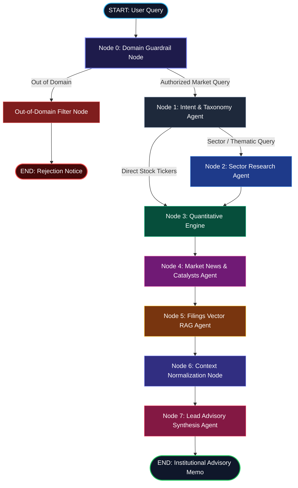

# FinRAG: LangGraph Multi-Agent Equity Intelligence

> An open-source, deterministic financial research platform for Indian equities (NSE & BSE) powered by **LangGraph**, **ChromaDB RAG**, and **Google Gemini**.

---

## Why FinRAG? (The Problem with Standard RAG & Raw Chatbots)

Most standard RAG setups take a PDF, chop it into chunks, and run cosine similarity search. That works for software manuals, but for the stock market, an annual report from eight months ago without knowing yesterday's breaking news or today's P/E ratio produces dangerously incomplete or hallucinated investment advice.

Similarly, asking a raw frontier LLM (like ChatGPT or raw Gemini) *"What is the better sector between Space and EV?"* results in generic conversational essays with no live stock prices, no actual valuation multiples, and zero deterministic data.

**FinRAG solves this by separating verified ground-truth data from probabilistic reasoning.** Whenever a query enters the system, a stateful LangGraph multi-agent pipeline coordinates:
1. **Domain Guardrails:** Blocks off-topic queries immediately to prevent hallucinations.
2. **Deterministic Exchange Ratios:** Queries live NSE/BSE fundamentals (P/E, Market Cap in ₹ Cr, ROE, 1-Year Returns, Debt-to-Equity).
3. **Live Breaking News:** Ingests real-time financial headlines from Reuters, Business Standard, and Google News India RSS.
4. **Corporate Filings (Annual Reports):** Vector search across parsed corporate filings.
5. **Lead Advisory Synthesis:** Constrains the LLM to write an institutional-grade investment memorandum based strictly on verified data.

---

## Architecture: LangGraph State Machine

FinRAG is built on official **LangGraph** (`from langgraph.graph import StateGraph, START, END`). Every user inquiry flows through the state graph below:



### The Agent Nodes in Detail

- **`guardrail_node` (First Line of Defense):** Checks if the query belongs to financial markets, investing, equities, or business analysis. If someone asks a random question (e.g. *"did you do web scraping to fetch data ?"* or *"write me a poem"*), the graph halts at Node 0 and politely informs the user that its field of expertise is strictly stock and financial market analysis.
- **`intent_agent`:** Parses stock symbols, handles Indian exchange naming quirks (NSE/BSE tickers), and decides whether the query is a single-stock deep-dive or a multi-sector comparison.
- **`sector_agent`:** Automatically expands broad thematic questions (like *"Space vs EV"* or *"Best renewable energy stocks"*) into representative peer baskets of actual listed companies (e.g. Space $\rightarrow$ MTAR Technologies, HAL, Data Patterns; EV $\rightarrow$ M&M, Olectra, Exide Industries, Tata Power).
- **`quant_engine`:** Ingests live exchange ratios (Current Price, Market Cap, Trailing P/E, ROE %, Revenue Growth, 1-Year Price Return, Debt/Equity).
- **`news_agent`:** Aggregates real-time financial news headlines and government policy updates (e.g. PLI schemes, export orders, subsidy packages).
- **`filings_rag`:** Semantic vector similarity search over parsed corporate annual reports (currently includes HAL, BDL, L&T, and Reliance Power).
- **`synthesis_agent`:** Feeds only verified tabular metrics and news into Gemini to draft a structured institutional equity research advisory memo.

---

## User Interfaces

### 1. Web Dashboard (Streamlit)
Includes:
- **Interactive LangGraph Architecture Expander:** Visualizes the active StateGraph and node transitions.
- **Audit Trail & Trace:** Real-time log showing each agent step, execution runtime in seconds, and tools fired.
- **Tabbed Advisory Workspace:**
  1. *📑 Institutional Advisory Memo:* Executive stance (Buy/Hold/Overweight), catalyst breakdown, and downside risk triggers.
  2. *📊 Valuation & Fundamentals Matrix:* Interactive DataFrame and key metric highlight cards.
  3. *📰 Breaking News & Catalyst Feed:* Clickable live headlines with dates and publisher tags.
  4. *🔬 LangGraph State Inspection:* Real-time JSON state verification.

```bash
streamlit run app.py
```

### 2. Terminal CLI (Bloomberg-Style Terminal)
A sleek, command-line interface with rich tables, agent audit progress bars, and markdown advisory dossiers:

```bash
python run_india_finrag.py
```

---

## Quickstart

### 1. Clone & Install Dependencies

```bash
git clone https://github.com/kawaiibaka0908/FinRag.git
cd FinRag
pip install -r requirements.txt
```

### 2. Set Up Free Gemini API Key

FinRAG runs entirely on Google's free-tier Gemini API (`gemini-3.5-flash-lite`, `gemini-3.8-flash`) with automatic fallback chains. No OpenAI or paid API key is required.

```bash
# Windows PowerShell
$env:GEMINI_API_KEY="your_api_key_here"

# Linux / macOS
export GEMINI_API_KEY="your_api_key_here"
```

### 3. Launch

```bash
# Launch Web App
streamlit run app.py

# Or Launch Terminal CLI
python run_india_finrag.py
```

---

## Project Structure

```text
FinRag/
├── app.py                                # Streamlit institutional web dashboard
├── run_india_finrag.py                   # Rich terminal CLI
├── requirements.txt                      # Dependencies (langgraph, streamlit, yfinance, google-genai, etc.)
├── data/                                 # Annual reports (PDFs) and ticker mappings
└── src/
    └── finrag/
        ├── orchestrator/
        │   ├── langgraph_orchestrator.py # Official LangGraph StateGraph engine with Guardrail
        │   └── india_orchestrator.py     # Pure-Python multi-agent orchestrator & sector agent
        ├── models/
        │   └── gemini_models.py          # Google Gemini model wrappers with auto-fallback chain
        ├── scoring/
        │   ├── news_fetcher.py           # Live RSS & Google News India feed aggregator
        │   └── financial_data_fetcher.py # Real-time NSE/BSE quant data collector (yfinance)
        └── vectorstore/                  # ChromaDB vector store for annual report RAG
```

---

## Tech Stack

- **Orchestration:** [LangGraph](https://github.com/langchain-ai/langgraph) (StateGraph, conditional routing)
- **Language Models:** Google Gemini (`google-genai` SDK v3+, zero-cost API)
- **Live Market Data:** Yahoo Finance API (`yfinance` for NSE/BSE quotes and ratios)
- **Live News Ingestion:** `feedparser` over Reuters, Business Standard & Google News India
- **Vector Search & RAG:** ChromaDB with local sentence embeddings
- **Frontends:** Streamlit (Web) & Rich (Terminal CLI)
